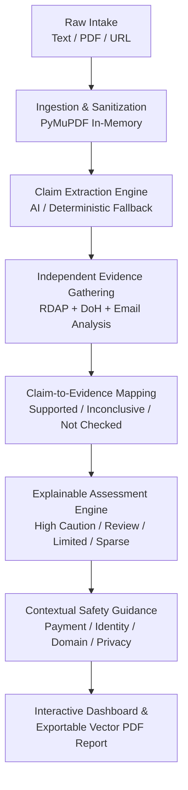

# OFFERPROOF

> **Don't trust the offer. Verify the evidence.**

OFFERPROOF is an AI-assisted, evidence-grounded opportunity verification platform designed to protect students, fresh graduates, and job seekers from deceptive employment scams, ghost jobs, and fraudulent internship or scholarship offers. Rather than relying on guesswork or black-box predictions, OFFERPROOF systematically evaluates opportunity claims against independent technical infrastructure evidence (RDAP domain registration, Cloudflare DNS-over-HTTPS, and email protocol consistency) to produce transparent, explainable safety assessments.

- **Live Demonstration Repository:** [https://github.com/Sanjaycs096/OFFERPROOF.git](https://github.com/Sanjaycs096/OFFERPROOF.git)
- **Current Hardened Version:** `v0.5.0`
- **Hackathon & Presentation Materials:**
  - [`DEMO_PRESENTATION_SCRIPT.md`](DEMO_PRESENTATION_SCRIPT.md): Complete presentation kit with 60s pitch, 3-min timed walkthrough, 14 judge technical Q&As, backup plan, and pre-flight checklist.
  - [`HACKATHON_SUBMISSION.md`](HACKATHON_SUBMISSION.md): Submission overview, competitive differentiation matrix, and student impact statements.

---

## The Problem

Recruitment and scholarship fraud is surging, particularly targeting vulnerable job seekers and early-career talent:
- **Upfront Fee Scams:** Imposters pose as reputable firms, demanding equipment fees, onboarding costs, registration fees, or visa processing charges.
- **Spoofed Communication:** Scammers utilize lookalike domain names or consumer webmail (`@gmail.com`, `@yahoo.com`) while posing as official enterprise hiring managers.
- **Credential Harvesting & Phantom Listings:** Fake listings harvest candidate resumes, personal identifiable information (PII), bank details, or government IDs.
- **Lack of Auditable Evidence:** Existing tools offer vague warnings, ungrounded speculation, or arbitrary black-box risk percentages without showing the verifiable proof behind an assessment.

OFFERPROOF bridges this gap by grounding every assessment in external, verifiable technical evidence and providing deterministic, explainable safety guidance.

---

## Current Status: Phase 5 — Product Hardening, Deployment & Submission (`v0.5.0`)

Phase 5 finalizes OFFERPROOF into a production-ready, hardened solution for demonstration and deployment:

1. **Production Hardening:**
   - Strict CORS configuration supporting wildcard and discrete origin environments.
   - Dynamic API base URL detection (`VITE_API_BASE_URL` & `VITE_API_URL`).
   - Graceful operation without AI API keys (automatic deterministic rule-based fallback).
   - In-memory PDF upload validation with strict 5 MB file size and 10-page limits.
   - Strict SSRF immunity (untrusted user URLs are never visited, downloaded, or executed).
2. **Demo Experience:**
   - One-click **"Demo Walkthrough"** button populating the official synthetic evaluation scenario (Machine Learning Internship at Apex Innovations).
   - Traceable claim-to-evidence scorecard with linked evidence chips.
3. **Printable / Exportable Vector Report:**
   - Client-side and native browser print styles (`@media print`) rendering a clean, professional PDF scorecard with unique report IDs, timestamps, findings, and disclaimers.
4. **Cloud Deployment Blueprint:**
   - Automated Render service blueprint (`render.yaml`) and Vercel routing configuration (`frontend/vercel.json`).

---

## Assessment Methodology & Categories

OFFERPROOF assessments are **guidance levels, not fraud verdicts**. The platform strictly avoids generating arbitrary AI confidence percentages (such as "87% scam risk") and never claims that an opportunity is definitely genuine or fraudulent based on technical checks alone.

### Assessment Guidance Levels

| Category Level | Assessment Label | Criteria & Observed Signals | Practical Meaning for Candidates |
| :--- | :--- | :--- | :--- |
| `high_caution` | **High caution** | An explicit request for upfront fees (registration, processing, training) OR multiple ($\ge 2$) independent technical/linguistic inconsistencies (e.g. newly registered domain + free email). | Immediate danger signals detected. Candidates must pause all transactions and not transfer funds or sensitive personal credentials. |
| `needs_careful_review` | **Needs careful review** | One meaningful warning indicator or unresolved inconsistency (e.g. recruiter uses free webmail, recent domain $<180$ days, domain mismatch, or pressure language). | Notable anomalies observed. Requires independent confirmation through official corporate directories before proceeding. |
| `limited_concerns_detected` | **Limited concerns detected** | Technical checks found active DNS routing, established domain age ($>180$ days), matching corporate email, HTTPS protocol, and no fee requests. | Few technical red flags detected. **Crucial Notice:** Technical consistency does NOT verify that the opportunity or organization is genuine. |
| `insufficient_evidence` | **Insufficient evidence** | Too little identifiable information was supplied (no website, no recruiter email, or external evidence providers unavailable). | Insufficient data to evaluate. Candidates must request official corporate details before evaluating. |

### Finding Severity Levels

Every assessment finding includes `finding_id`, `title`, `severity`, `explanation`, `related_claim_ids`, `related_evidence_ids`, `why_it_matters`, `limitations`, and `recommended_action`:
- `high_caution`: Critical signals requiring immediate cessation of payment or data transmission (e.g. upfront fee demands).
- `caution`: Meaningful technical or operational inconsistencies (e.g. free webmail, recent domain, unencrypted HTTP).
- `informational`: Contextual observations providing situational awareness (e.g. relatively recent domain, normal operation parameters).

---

## The End-to-End OFFERPROOF Pipeline



1. **Ingest Opportunity:** Accept pasted job/internship copy, uploaded text-based PDFs (parsed in-memory via PyMuPDF), or application URLs.
2. **Extract Entities & Claims:** Isolate organizational entities, financial terms, recruiter contacts, and suspicious linguistic patterns without computing risk scores.
3. **Collect Technical Evidence:** Query authoritative RDAP directories and Cloudflare DNS-over-HTTPS (A, AAAA, MX, NS, TXT) with strict SSRF filtering.
4. **Map Evidence to Claims:** Update claim statuses to `supported`, `contradicted`, `inconclusive`, or `not_checked`. Retain financial terms and job openings as strictly `not_checked`.
5. **Generate Explainable Findings:** Traceable findings linking to real claims and evidence items without hallucinated evidence.
6. **Produce Contextual Recommendations:** Prioritized, actionable checklist (Payment safety, Identity verification, Domain checks, PII protection).
7. **Deliver Exportable Report:** High-resolution printable report with report ID, analysis timestamp, OfferProof branding, and transparent limitations disclaimers.

---

## What the System Can and Cannot Verify

### What We Can Independently Verify
- Whether a domain name exists and when it was registered via RDAP registries.
- Whether a hostname has active public DNS routing (`A`, `AAAA`, `NS`) and mail exchangers (`MX`).
- Whether the recruiter's email domain matches the opportunity website or uses a consumer webmail provider (`gmail.com`, `yahoo.com`, `outlook.com`).
- Whether an application URL uses encrypted HTTPS and whether it points to a raw IP address.
- Whether the application URL domain matches or diverges from the stated organisation domain.

### What We Cannot Verify (Strictly Retained as `not_checked`)
- **Job/Internship Availability:** DNS routing cannot verify whether an internal job vacancy exists.
- **Compensation & Stipends:** Salaries cannot be confirmed through domain registration records.
- **Application Fees:** Demanded registration fees cannot be verified via public technical registries.
- **Recruiter Authorization:** An email with a matching domain name can still be spoofed without cryptographic email headers (SPF/DKIM/DMARC inspection on raw `.eml` files).
- **Legitimacy from Age:** Older domains can be compromised; new domains may belong to legitimate startups.

---

## Technology Stack

### Frontend
- **Framework:** React 18
- **Build Tool:** Vite 5
- **Styling:** Tailwind CSS (Navy / Cyber Slate cybersecurity SaaS theme)
- **Icons:** Lucide React
- **Language:** JavaScript (ES Modules)
- **Exporting:** Browser Print Styles (`@media print`) for clean vector PDF report generation
- **Deployment Target:** Vercel (`frontend/vercel.json`)

### Backend
- **Framework:** FastAPI (Asynchronous Python)
- **ASGI Server:** Uvicorn
- **Document Parsing:** PyMuPDF (`pymupdf`)
- **Multipart Form Uploads:** `python-multipart`
- **Data Validation & Schemas:** Pydantic v2 & Pydantic-Settings
- **HTTP Client (Async):** HTTPX
- **Environment Management:** python-dotenv
- **Language:** Python 3.10+
- **Deployment Target:** Render Blueprint (`render.yaml`) / Heroku / Railway

---

## API Endpoints

| Method | Endpoint | Description |
| :--- | :--- | :--- |
| `GET` | `/` | Basic API information, documentation links, and platform version. |
| `GET` | `/health` | Service health status and environment metadata. |
| `GET` | `/api/v1/health` | Versioned health reporting ingestion, verification, and assessment engine capabilities. |
| `POST` | `/api/v1/ingest/text` | Ingests pasted opportunity text, returns sanitized text and parsed URL hostname. |
| `POST` | `/api/v1/ingest/pdf` | Uploads a text-based PDF (`multipart/form-data`), extracts text in-memory via PyMuPDF. |
| `POST` | `/api/v1/extract` | Extracts structured entities, atomic claims, and suspicious language indicators. |
| `POST` | `/api/v1/verify` | Evaluates extracted claims against independent technical evidence (RDAP, DoH, email). |
| `POST` | `/api/v1/assess` | Generates explainable assessment findings, guidance category, and recommendations. |
| `POST` | `/api/v1/analyze` | Unified pipeline executing ingestion, extraction, verification, and explainable assessment. |

Interactive API documentation is available at `http://localhost:8000/docs` (Swagger UI) and `http://localhost:8000/redoc`.

---

## Cloud Deployment Instructions

### Option 1: Frontend on Vercel
1. Fork or clone this repository to your GitHub account.
2. In the [Vercel Dashboard](https://vercel.com/), select **Add New Project** and import the repository.
3. Configure the project:
   - **Framework Preset:** Vite
   - **Root Directory:** `frontend`
   - **Build Command:** `npm run build`
   - **Output Directory:** `dist`
4. Add the Environment Variable:
   - `VITE_API_BASE_URL`: `https://your-backend-service.onrender.com`
5. Click **Deploy**. Vercel will build the frontend using [`frontend/vercel.json`](frontend/vercel.json).

### Option 2: Backend on Render
1. In the [Render Dashboard](https://dashboard.render.com/), click **New** > **Blueprint**.
2. Connect your GitHub repository.
3. Render will read [`render.yaml`](render.yaml) automatically:
   - **Service Name:** `offerproof-api`
   - **Runtime:** Python
   - **Root Directory:** `backend`
   - **Build Command:** `pip install -r requirements.txt`
   - **Start Command:** `uvicorn app.main:app --host 0.0.0.0 --port $PORT`
   - **Health Check Path:** `/health`
4. Configure Environment Variables in Render:
   - `ENVIRONMENT`: `production`
   - `CORS_ORIGINS`: `https://your-frontend.vercel.app` (or `*`)
   - `AI_PROVIDER`: `none` (or `gemini` / `openai` if API keys are provided)
5. Click **Apply**. Once live, update your frontend `VITE_API_BASE_URL` with Render's service URL.

---

## Installation & Local Development

### Prerequisites
- [Node.js](https://nodejs.org/) (v18.0.0 or higher recommended)
- [Python](https://www.python.org/) (v3.10 or higher recommended)
- [Git](https://git-scm.com/)

### Quick Demo Launch (Windows)

For judges, evaluators, and testers on Windows, launch the entire application with one command:

```cmd
run_demo.bat
```

This automated launcher will:
1. Verify system prerequisites (`python`, `node`, `npm`).
2. Automatically create the Python virtual environment (`backend\.venv`) and install dependencies if needed.
3. Automatically install frontend `node_modules` if needed.
4. Start the FastAPI backend on `http://127.0.0.1:8000` in a dedicated terminal window.
5. Start the Vite frontend on `http://localhost:5173` in a dedicated terminal window.
6. Open `http://localhost:5173` in your default web browser after initialization.

**Local Endpoints:**
- **Frontend Dashboard:** [http://localhost:5173](http://localhost:5173)
- **Backend Swagger API Docs:** [http://127.0.0.1:8000/docs](http://127.0.0.1:8000/docs)
- **Backend Health Check:** [http://127.0.0.1:8000/api/v1/health](http://127.0.0.1:8000/api/v1/health)

**How to Stop Services:**
- Close the two opened terminal windows (`OFFERPROOF - Backend API` and `OFFERPROOF - Frontend Web UI`) or press `Ctrl+C` in each window.

**Live Presentation & Judge Q&A Guide:**
- Review [`DEMO_PRESENTATION_SCRIPT.md`](DEMO_PRESENTATION_SCRIPT.md) for the 60-second pitch, 3-minute timed live walkthrough, technical explanation, 14 judge technical Q&As, and pre-flight checklist.

---

### Manual Setup (Cross-Platform)

#### 1. Clone & Set Up Backend
```bash
git clone https://github.com/Sanjaycs096/OFFERPROOF.git
cd OFFERPROOF/backend

# Create virtual environment
python -m venv .venv

# Activate virtual environment
# Windows (PowerShell):
.\.venv\Scripts\Activate.ps1
# macOS/Linux:
source .venv/bin/activate

# Install dependencies
pip install -r requirements.txt

# Start backend server
uvicorn app.main:app --reload --host 0.0.0.0 --port 8000
```
Backend API will be live at `http://localhost:8000`.

### 2. Set Up & Start Frontend
```bash
cd ../frontend

# Install dependencies
npm install

# Start development server
npm run dev
```
Frontend will be live at `http://localhost:5173`.

---

## Running Automated Test Suites

OFFERPROOF includes 7 automated regression test suites covering the entire platform:

```bash
# 1. PDF Ingestion, Headers & Limits
.\backend\.venv\Scripts\python.exe backend\tests\test_pdf.py

# 2. Claim Extraction & Rule-Based Fallback Engine
.\backend\.venv\Scripts\python.exe backend\tests\test_extraction.py

# 3. Ingestion API Endpoints (Multipart PDF upload, text ingestion)
.\backend\.venv\Scripts\python.exe backend\tests\test_ingestion.py

# 4. Evidence Verification (Mocked RDAP, DoH, Email, URL consistency)
.\backend\.venv\Scripts\python.exe backend\tests\test_verification.py

# 5. Assessment Engine (All 4 categories, findings, recommendations)
.\backend\.venv\Scripts\python.exe backend\tests\test_assessment.py

# 6. Core API Regression & CORS Preflight Tests
.\backend\.venv\Scripts\python.exe backend\tests\test_api.py

# 7. Live HTTP Server Socket Integration Test
.\backend\.venv\Scripts\python.exe backend\tests\test_live_server.py
```

---

## Development Roadmap

- [x] **Phase 1: Project Foundation**
  - Full-stack repository structure.
  - React 18 + Vite frontend and asynchronous FastAPI backend.
  - Bidirectional health checks and CORS integration.

- [x] **Phase 2: Ingestion & Claim Extraction**
  - Multi-source ingestion: raw text, text-based PDF parsing via in-memory PyMuPDF, and SSRF-safe URL references.
  - Atomic claim extraction engine isolating verifiable claims (`verification_status="not_checked"`).
  - Pluggable AI extraction architecture with deterministic rule-based fallback.
  - Suspicious language indicator extraction without concluding fraud.

- [x] **Phase 3: Independent Evidence Verification & Source Intelligence**
  - Domain intelligence via RDAP (registration timestamp, registrar, domain age interpretation).
  - DNS intelligence via DNS-over-HTTPS (A, AAAA, MX, NS, TXT).
  - Recruiter email-domain consistency and consumer webmail detection.
  - URL transport protocol and domain divergence inspection (no external page scraping).
  - Claim-to-evidence mapper assigning `supported`, `contradicted`, `inconclusive`, and `not_checked` states.

- [x] **Phase 4: Explainable Opportunity Assessment & Safety Intelligence**
  - Deterministic assessment engine generating 4 explainable categories (`high_caution`, `needs_careful_review`, `limited_concerns_detected`, `insufficient_evidence`).
  - Evidence-based findings with severity, explanation, why it matters, limitations, and recommended actions.
  - Contextual safety recommendations (Payment safety, Identity verification, Domain integrity, Data privacy).
  - Clear separation of verified technical facts vs unverified claims.
  - Prioritized actionable next-steps checklist for students.

- [x] **Phase 5: Product Hardening, Deployment & Hackathon Submission (Current - `v0.5.0`)**
  - Fictional demonstration scenario with one-click walkthrough button.
  - Exportable / printable report with official OfferProof branding, report ID, date, and methodology disclaimers.
  - Production deployment configuration (`render.yaml`, `vercel.json`, `Procfile`).
  - End-to-end regression validation and hackathon pitch kit (`HACKATHON_SUBMISSION.md`).

---

## Safety and Privacy

OFFERPROOF operates strictly on publicly verifiable organizational claims and technical infrastructure signals. Users must **not** submit sensitive Personal Identifiable Information (PII) such as Social Security Numbers, banking credentials, or personal identification cards. All verification outputs are decision-support resources designed to aid in diligence, not formal legal counsel.

---

## License

This project is licensed under the [MIT License](LICENSE).
