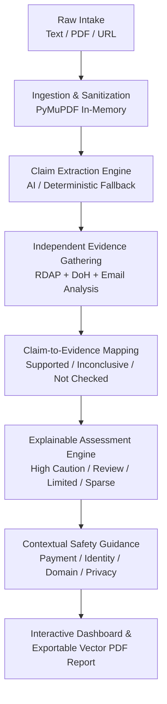

# OFFERPROOF

> **Don't trust the offer. Verify the evidence.**

OFFERPROOF is an AI-assisted, evidence-based opportunity verification platform designed to protect students, fresh graduates, and job seekers from deceptive employment scams, ghost jobs, and fraudulent internship or scholarship offers. Rather than relying on guesswork or black-box predictions, OFFERPROOF systematically evaluates opportunity claims against independent technical infrastructure evidence (RDAP domain registration, Cloudflare DNS-over-HTTPS, and email protocol consistency) to produce transparent, explainable safety assessments.

---

## The Problem

Recruitment and scholarship fraud is surging, particularly targeting vulnerable job seekers and early-career talent:
- **Upfront Fee Scams:** Imposters pose as reputable firms, demanding equipment fees, onboarding costs, registration fees, or visa processing charges.
- **Spoofed Communication:** Scammers utilize lookalike domain names or consumer webmail (`@gmail.com`, `@yahoo.com`) while posing as official enterprise hiring managers.
- **Credential Harvesting & Phantom Listings:** Fake listings harvest candidate resumes, personal identifiable information (PII), bank details, or government IDs.
- **Lack of Auditable Evidence:** Existing tools offer vague warnings, ungrounded speculation, or arbitrary black-box risk percentages without showing the verifiable proof behind an assessment.

OFFERPROOF bridges this gap by grounding every assessment in external, verifiable technical evidence and providing deterministic, explainable safety guidance.

---

## Current Status: Phase 4 — Explainable Opportunity Assessment & Safety Intelligence

Phase 4 synthesizes extracted claims, technical observations, and independent evidence into a deterministic, explainable assessment report that answers the questions that matter most to students:

1. **What does the opportunity announcement claim?** (Roles, stated entities, financial figures, deadlines)
2. **What evidence was actually checked?** (RDAP domain age, DNS A/MX routing, recruiter email domain alignment, HTTPS encryption)
3. **What concerning indicators were found?** (Upfront fee requests, free webmail recruitment, newly registered domains, domain divergence, pressure language)
4. **Which claims remain unverified?** (Salaries, stipends, hiring guarantees, job vacancies, and deadlines)
5. **What should the student do before applying or paying?** (Prioritized actionable next-steps checklist)
6. **What information should the student independently confirm?** (Corporate registries, official careers pages, verified HR directories)

---

## Assessment Methodology & Categories

OFFERPROOF assessments are **guidance levels, not fraud verdicts**. The platform strictly avoids generating arbitrary AI confidence percentages (such as "87% scam risk") and never claims that an opportunity is definitely genuine or fraudulent based on technical checks alone.

### Assessment Guidance Levels

| Category Level | Assessment Label | Criteria & Observed Signals | Practical Meaning for Candidates |
| :--- | :--- | :--- | :--- |
| `high_caution` | **High caution** | An explicit request for upfront fees (registration, processing, training) OR multiple ($\ge 2$) independent technical/linguistic inconsistencies (e.g. newly registered domain + free email). | Immediate danger signals detected. Candidates must pause all transactions and not transfer funds or sensitive personal credentials. |
| `needs_careful_review` | **Needs careful review** | One meaningful warning indicator or unresolved inconsistency (e.g. recruiter uses free webmail, recent domain $<180$ days, domain mismatch, or pressure language). | Notable anomalies observed. Requires independent confirmation through official corporate directories before proceeding. |
| `limited_concerns_detected` | **Limited concerns detected** | Technical checks found active DNS routing, established domain age ($>180$ days), matching corporate email, HTTPS protocol, and no fee requests. | Few technical red flags detected. **Crucial Notice:** Technical consistency does NOT verify that the opportunity or organization is genuine. |
| `insufficient_evidence` | **Insufficient evidence** | Too little identifiable information was supplied (no website, no recruiter email, or external evidence providers unavailable). | Insufficient data to evaluate. Candidates must request official corporate details before evaluating. |

### Finding Severity Levels

Every assessment finding includes `finding_id`, `title`, `severity`, `explanation`, `related_claim_ids`, `related_evidence_ids`, `why_it_matters`, `limitations`, and `recommended_action`:
- `high_caution`: Critical signals requiring immediate cessation of payment or data transmission (e.g. upfront fee demands).
- `caution`: Meaningful technical or operational inconsistencies (e.g. free webmail, recent domain, unencrypted HTTP).
- `informational`: Contextual observations providing situational awareness (e.g. relatively recent domain, normal operation parameters).

---

## The End-to-End OFFERPROOF Pipeline



1. **Ingest Opportunity:** Accept pasted job/internship copy, uploaded text-based PDFs (parsed in-memory via PyMuPDF), or application URLs.
2. **Extract Entities & Claims:** Isolate organizational entities, financial terms, recruiter contacts, and suspicious linguistic patterns without computing risk scores.
3. **Collect Technical Evidence:** Query authoritative RDAP directories and Cloudflare DNS-over-HTTPS (A, AAAA, MX, NS, TXT) with strict SSRF filtering.
4. **Map Evidence to Claims:** Update claim statuses to `supported`, `contradicted`, `inconclusive`, or `not_checked`. Retain financial terms and job openings as strictly `not_checked`.
5. **Generate Explainable Findings:** Traceable findings linking to real claims and evidence items without hallucinated evidence.
6. **Produce Contextual Recommendations:** Prioritized, actionable checklist (Payment safety, Identity verification, Domain checks, PII protection).
7. **Deliver Exportable Report:** High-resolution printable report with report ID, analysis timestamp, OfferProof branding, and transparent limitations disclaimers.

---

## What the System Can and Cannot Verify

### What We Can Independently Verify
- Whether a domain name exists and when it was registered via RDAP registries.
- Whether a hostname has active public DNS routing (`A`, `AAAA`, `NS`) and mail exchangers (`MX`).
- Whether the recruiter's email domain matches the opportunity website or uses a consumer webmail provider (`gmail.com`, `yahoo.com`, `outlook.com`).
- Whether an application URL uses encrypted HTTPS and whether it points to a raw IP address.
- Whether the application URL domain matches or diverges from the stated organisation domain.

### What We Cannot Verify (Strictly Retained as `not_checked`)
- **Job/Internship Availability:** DNS routing cannot verify whether an internal job vacancy exists.
- **Compensation & Stipends:** Salaries cannot be confirmed through domain registration records.
- **Application Fees:** Demanded registration fees cannot be verified via public technical registries.
- **Recruiter Authorization:** An email with a matching domain name can still be spoofed without cryptographic email headers (SPF/DKIM/DMARC inspection on raw `.eml` files).
- **Legitimacy from Age:** Older domains can be compromised; new domains may belong to legitimate startups.

---

## Technology Stack

### Frontend
- **Framework:** React 18
- **Build Tool:** Vite 5
- **Styling:** Tailwind CSS (Navy / Cyber Slate cybersecurity SaaS theme)
- **Icons:** Lucide React
- **Language:** JavaScript (ES Modules)
- **Exporting:** Browser Print Styles (`@media print`) for clean vector PDF report generation

### Backend
- **Framework:** FastAPI (Asynchronous Python)
- **ASGI Server:** Uvicorn
- **Document Parsing:** PyMuPDF (`pymupdf`)
- **Multipart Form Uploads:** `python-multipart`
- **Data Validation & Schemas:** Pydantic v2 & Pydantic-Settings
- **HTTP Client (Async):** HTTPX
- **Environment Management:** python-dotenv
- **Language:** Python 3.10+

### DevOps & Tooling
- **Version Control:** Git & GitHub
- **Package Managers:** npm (Frontend), pip (Backend)
- **Virtual Environment:** Python venv

---

## Project Structure

```
OFFERPROOF/
├── frontend/
│   ├── public/
│   │   └── shield.svg               # Branding icon
│   ├── src/
│   │   ├── components/
│   │   │   ├── Navbar.jsx           # Header with real-time API health badge
│   │   │   ├── Hero.jsx             # Hero section and value propositions
│   │   │   ├── SubmissionForm.jsx   # Ingestion intake with PDF dropzone and Phase 4 pipeline
│   │   │   ├── ExtractionResults.jsx# Opportunity Assessment Dashboard, Findings, & PDF Export
│   │   │   ├── HowItWorks.jsx       # 4-stage verification pipeline explanation
│   │   │   ├── Disclaimer.jsx       # Safety, privacy, and PII protection guidance
│   │   │   ├── Footer.jsx           # Project credits, repo links, and metadata
│   │   │   └── StatusBadge.jsx      # API connection & latency indicator
│   │   ├── pages/
│   │   │   └── LandingPage.jsx      # Primary dashboard landing layout
│   │   ├── services/
│   │   │   └── api.js               # API client (ingest, extract, verify, assess, analyze)
│   │   ├── hooks/
│   │   │   └── useHealthCheck.js    # React hook monitoring backend status
│   │   ├── App.jsx                  # Main component root
│   │   ├── main.jsx                 # Vite application mount point
│   │   └── index.css                # Tailwind directives & global print styling
│   ├── index.html                   # HTML template
│   ├── package.json                 # Frontend dependencies and scripts
│   ├── vite.config.js               # Vite bundler configuration
│   └── tailwind.config.js           # Custom typography and cybersecurity palette
│
├── backend/
│   ├── app/
│   │   ├── routes/
│   │   │   ├── __init__.py          # API route registry
│   │   │   ├── health.py            # Health check endpoint (/health)
│   │   │   ├── ingestion.py         # Ingestion endpoints (/api/v1/ingest/..., /api/v1/extract)
│   │   │   └── verification.py      # Verification & Assessment (/verify, /assess, /analyze)
│   │   ├── schemas/
│   │   │   ├── __init__.py          # Schema exports
│   │   │   ├── health.py            # Health and root response models
│   │   │   ├── ingestion.py         # Ingestion request and response models
│   │   │   ├── extraction.py        # Claims and entity extraction models
│   │   │   ├── evidence.py          # Evidence items and technical observation models
│   │   │   ├── verification.py      # Verification request and response models
│   │   │   └── assessment.py        # NEW: AssessmentOverview, Finding, Recommendation, Report
│   │   ├── services/
│   │   │   ├── __init__.py          # Service exports
│   │   │   ├── health_service.py    # Health inspection logic
│   │   │   ├── pdf_service.py       # In-memory PyMuPDF validation and text extraction
│   │   │   ├── ingestion_service.py # Text sanitization and SSRF-safe URL parsing
│   │   │   ├── fallback_extractor.py# Deterministic regex and pattern-based extractor
│   │   │   ├── ai_service.py        # Modular AI provider abstraction (Gemini / OpenAI)
│   │   │   ├── extraction_service.py# Extraction pipeline coordinator
│   │   │   ├── verification_service.py # Evidence coordinator and claim mapper
│   │   │   ├── recommendation_service.py # NEW: Safety guidance and next-steps generator
│   │   │   ├── assessment_service.py   # NEW: Deterministic explainable assessment engine
│   │   │   └── evidence/            # Modular Evidence Providers
│   │   │       ├── base.py          # BaseEvidenceProvider, hostname normalization, SSRF safety
│   │   │       ├── domain_service.py# RDAP domain age, registrar, and status provider
│   │   │       ├── dns_service.py   # DNS-over-HTTPS (DoH) resolver (A, MX, NS, TXT)
│   │   │       ├── email_service.py # Recruiter email-domain alignment & webmail provider check
│   │   │       ├── url_service.py   # URL scheme, raw IP, and domain divergence inspection
│   │   │       └── organisation_service.py # Name-to-domain alignment & corporate registry adapter
│   │   ├── __init__.py              # Backend package metadata (v0.4.0)
│   │   └── main.py                  # FastAPI application entry point, CORS, and root GET /
│   ├── tests/
│   │   ├── test_api.py              # Automated API, CORS, verify, assess, and analyze tests
│   │   ├── test_pdf.py              # PyMuPDF extraction, size and page limit tests
│   │   ├── test_extraction.py       # Entity, claim, and AI fallback test suite
│   │   ├── test_ingestion.py        # Multipart PDF and text ingestion endpoint tests
│   │   ├── test_verification.py     # Mocked RDAP, DoH, email, URL, and claim mapping tests
│   │   ├── test_assessment.py       # NEW: Unit tests for all 4 assessment categories & findings
│   │   └── test_live_server.py      # Live Uvicorn server socket test across all phases
│   ├── requirements.txt             # Backend Python dependencies
│   └── .env.example                 # Backend environment template
│
├── .gitignore                       # Multi-stack Git ignore rules
├── LICENSE                          # MIT License
└── README.md                        # Project documentation
```

---

## API Endpoints

| Method | Endpoint | Description |
| :--- | :--- | :--- |
| `GET` | `/` | Basic API information and documentation links. |
| `GET` | `/health` | Service health status and environment metadata. |
| `GET` | `/api/v1/health` | Versioned health reporting ingestion, verification, and assessment engine capabilities. |
| `POST` | `/api/v1/ingest/text` | Ingests pasted opportunity text, returns sanitized text and parsed URL hostname. |
| `POST` | `/api/v1/ingest/pdf` | Uploads a text-based PDF (`multipart/form-data`), extracts text in-memory via PyMuPDF. |
| `POST` | `/api/v1/extract` | Extracts structured entities, atomic claims, and suspicious language indicators. |
| `POST` | `/api/v1/verify` | Evaluates extracted claims against independent technical evidence (RDAP, DoH, email). |
| `POST` | `/api/v1/assess` | NEW: Generates explainable assessment findings, guidance category, and recommendations. |
| `POST` | `/api/v1/analyze` | Unified pipeline executing ingestion, extraction, verification, and explainable assessment. |

Interactive API documentation is available at `http://localhost:8000/docs` (Swagger UI) and `http://localhost:8000/redoc`.

---

## Example Assessment Response (`POST /api/v1/assess`)

```json
{
  "success": true,
  "assessment": {
    "assessment_level": "high_caution",
    "assessment_label": "High caution",
    "summary": "High caution recommended. An upfront registration, processing, or training fee was requested. Legitimate employers do not charge fees to candidates. Independently verify the organization before paying or applying.",
    "important_notice": "This is an evidence-based assessment, not a guarantee of legitimacy or fraud. Never make financial payments or share sensitive documents based on unverified announcements."
  },
  "findings": [
    {
      "finding_id": "FND-001",
      "title": "Upfront registration, processing, or training fee requested",
      "severity": "high_caution",
      "explanation": "The announcement explicitly requests an upfront payment before proceeding: Registration fee: ₹1,500. Legitimate employers and reputable scholarship providers almost never require candidates to pay fees to secure work or onboarding.",
      "related_claim_ids": ["CLM-002"],
      "related_evidence_ids": [],
      "why_it_matters": "Demanding upfront fees is the single most common pattern in recruitment fraud. Once money is transferred, candidates rarely receive the promised role or refund.",
      "limitations": "The text confirms that a payment is requested, but technical checks cannot ascertain the legal identity or motives of the sender. Some academic contests or certification exams charge entry fees.",
      "recommended_action": "Do not pay any fee or deposit. Independently contact the organization through their verified public careers directory to verify whether any payment request is authentic."
    },
    {
      "finding_id": "FND-002",
      "title": "Recruiter contact utilizes a free webmail service (@gmail.com)",
      "severity": "caution",
      "explanation": "The recruiter contact (recruiter@gmail.com) uses a free public email provider (@gmail.com) rather than an authenticated corporate domain corresponding to the claimed organization.",
      "related_claim_ids": ["CLM-003"],
      "related_evidence_ids": ["EVD-003"],
      "why_it_matters": "Established organizations almost always communicate through company-owned, authenticated email domains. Public webmail accounts can be created anonymously by anyone.",
      "limitations": "Using a free webmail service does not prove fraud. Small startups and independent researchers sometimes use consumer webmail for communication.",
      "recommended_action": "Request communication from the recruiter's official company email address, and confirm their employment status with the organization's HR department before sharing personal details."
    }
  ],
  "recommendations": [
    {
      "recommendation_id": "REC-001",
      "topic": "payment_safety",
      "title": "Do not pay any upfront registration, processing, or training fee",
      "advice": "Legitimate employers, internship hosts, and reputable scholarship providers do not require candidates to pay upfront fees to secure a position or undergo onboarding. Do not send money, gift cards, or cryptocurrency.",
      "priority": 1
    },
    {
      "recommendation_id": "REC-002",
      "topic": "personal_info",
      "title": "Protect sensitive personal, financial, and identity records",
      "advice": "Never disclose bank account details, credit card numbers, OTPs, account passwords, or national identity documents during initial outreach.",
      "priority": 1
    },
    {
      "recommendation_id": "REC-003",
      "topic": "recruiter_identity",
      "title": "Independently verify the recruiter's identity and organizational authority",
      "advice": "Search for the company's verified website or telephone switchboard, contact their HR department through independently verified channels, and ask to confirm that this individual is authorized to recruit on their behalf.",
      "priority": 2
    }
  ],
  "verified_facts": [
    {
      "fact_id": "FCT-001",
      "category": "domain",
      "statement": "Domain 'abctech.example.com' was registered with NameCheap on 2026-09-15 (46 days ago).",
      "source_name": "RDAP",
      "retrieved_at": "2026-10-31T04:52:55Z"
    },
    {
      "fact_id": "FCT-002",
      "category": "dns",
      "statement": "Domain 'abctech.example.com' has 1 active IPv4 (A) record(s) resolving to 93.184.216.34.",
      "source_name": "Cloudflare DoH",
      "retrieved_at": "2026-10-31T04:52:55Z"
    }
  ],
  "unverified_claims": [
    {
      "claim_id": "CLM-002",
      "category": "financial",
      "statement": "Advertised monthly stipend is ₹45,000 per month.",
      "reason_unverified": "Salary figures, stipend amounts, and fee requirements cannot be confirmed through technical network records."
    }
  ],
  "next_steps": [
    {
      "step_number": 1,
      "action": "Pause all payment workflows immediately and do not transfer funds.",
      "rationale": "Legitimate employers do not require candidates to pay application or equipment fees upfront."
    },
    {
      "step_number": 2,
      "action": "Navigate independently to the organization's official website via a search engine.",
      "rationale": "Ensures you are evaluating the authentic corporate portal rather than an unverified lookalike link."
    },
    {
      "step_number": 3,
      "action": "Confirm the vacancy on the official company careers board or via their HR department.",
      "rationale": "Validates that the position exists and has been authorized by the organization."
    }
  ],
  "limitations": [
    "OfferProof assessments evaluate publicly accessible technical signals (DNS, RDAP, email domains, URL protocols). They cannot inspect private employer databases.",
    "Assessment categories are safety guidance levels, not legal determinations or definitive fraud verdicts."
  ]
}
```

---

## Installation & Setup Instructions

### Prerequisites
- [Node.js](https://nodejs.org/) (v18.0.0 or higher recommended)
- [Python](https://www.python.org/) (v3.10 or higher recommended)
- [Git](https://git-scm.com/)

---

### Running Automated Test Suites

Execute all Phase 1, Phase 2, Phase 3, and Phase 4 automated test suites:

```bash
# PDF Ingestion & Limits
.\backend\.venv\Scripts\python.exe backend\tests\test_pdf.py

# Claim Extraction & Fallback Engine
.\backend\.venv\Scripts\python.exe backend\tests\test_extraction.py

# Ingestion API Endpoints (Multipart PDF upload, text ingestion)
.\backend\.venv\Scripts\python.exe backend\tests\test_ingestion.py

# Evidence Verification (Mocked RDAP, DoH, Email, URL consistency)
.\backend\.venv\Scripts\python.exe backend\tests\test_verification.py

# Phase 4 Assessment Engine (All 4 categories, findings, recommendations)
.\backend\.venv\Scripts\python.exe backend\tests\test_assessment.py

# Core API Regression & CORS Preflight Tests
.\backend\.venv\Scripts\python.exe backend\tests\test_api.py

# Live HTTP Server Socket Test
.\backend\.venv\Scripts\python.exe backend\tests\test_live_server.py
```

---

## Development Roadmap

- [x] **Phase 1: Project Foundation**
  - Establish full-stack repository structure.
  - Configure modern React + Vite frontend and asynchronous FastAPI backend.
  - Implement bidirectional health check and CORS integration.

- [x] **Phase 2: Ingestion & Claim Extraction**
  - Multi-source ingestion: raw text, text-based PDF parsing via in-memory PyMuPDF, and SSRF-safe URL references.
  - Atomic claim extraction engine isolating verifiable claims (`verification_status="not_checked"`).
  - Pluggable AI extraction architecture with deterministic rule-based fallback.
  - Suspicious language indicator extraction without concluding fraud.

- [x] **Phase 3: Independent Evidence Verification & Source Intelligence**
  - Domain intelligence via RDAP (registration timestamp, registrar, domain age interpretation).
  - DNS intelligence via DNS-over-HTTPS (A, AAAA, MX, NS, TXT).
  - Recruiter email-domain consistency and consumer webmail detection.
  - URL transport protocol and domain divergence inspection (no external page scraping).
  - Claim-to-evidence mapper assigning `supported`, `contradicted`, `inconclusive`, and `not_checked` states.

- [x] **Phase 4: Explainable Opportunity Assessment & Safety Intelligence (Current)**
  - Deterministic assessment engine generating 4 explainable categories (`high_caution`, `needs_careful_review`, `limited_concerns_detected`, `insufficient_evidence`).
  - Evidence-based findings with severity, explanation, why it matters, limitations, and recommended actions.
  - Contextual safety recommendations (Payment safety, Identity verification, Domain integrity, Data privacy).
  - Clear separation of verified technical facts vs unverified claims.
  - Prioritized actionable next-steps checklist for students.
  - Exportable / printable report with official OfferProof branding, report ID, date, and methodology disclaimers.

- [ ] **Phase 5: Automated Registry Verification & Community Signal Aggregation**
  - Direct integration with authoritative business registers (SEC EDGAR, UK Companies House, MCA).
  - Aggregated anonymous reporting signals and institutional student defense feeds.

---

## Safety and Privacy

OFFERPROOF operates strictly on publicly verifiable organizational claims and technical infrastructure signals. Users must **not** submit sensitive Personal Identifiable Information (PII) such as Social Security Numbers, banking credentials, or personal identification cards. All verification outputs are decision-support resources designed to aid in diligence, not formal legal counsel.

---

## License

This project is licensed under the [MIT License](LICENSE).
